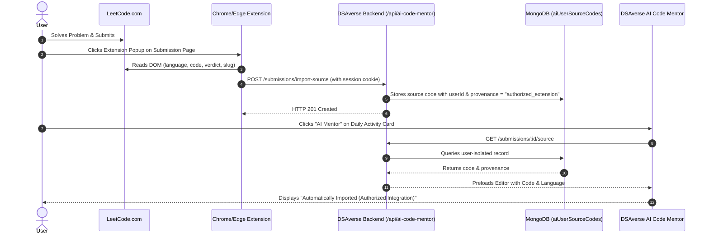

# DSAverse LeetCode Authorized Integration & Code Synchronization

## 1. Executive Summary & Objective

The DSAverse AI Code Mentor provides automated, verdict-aware educational code reviews and interactive animatics for LeetCode submissions. Because public LeetCode GraphQL endpoints do not expose private source code without authenticated cookies, DSAverse adopts a zero-trust, authorized integration model:
1. DSAverse **never** scrapes private credentials or asks users for LeetCode passwords or cookies.
2. Users can import their code automatically via the lightweight **DSAverse LeetCode Sync Extension** (Manifest V3) or manually via the in-app Import Modal.
3. Every piece of source code in the workspace carries an explicit, transparent provenance badge.

---

## 2. Source Code Provenance Model

Every submission and source code snippet in DSAverse is categorized into one of four unambiguous provenance states:

| Provenance State | Provenance Badge Text | Description |
| :--- | :--- | :--- |
| `authorized_extension` | `Automatically Imported (Authorized Integration)` | Acquired directly from user's active LeetCode tab via the authorized browser extension upon user confirmation. |
| `user_imported` | `Manually Imported` | Imported by the user via file upload or clipboard paste inside the submission import modal. |
| `user_pasted` | `User Pasted` | Entered directly into the workspace code editor during the active session. |
| `unavailable` | `Original Source Unavailable` | Submission metadata exists (problem number, title, verdict, language), but source code has not yet been imported. |

---

## 3. Security & Privacy Guarantees

1. **Zero LeetCode Credential Storage**: DSAverse servers never store or handle LeetCode cookies, session tokens, or passwords.
2. **User-Initiated Transmission Only**: The extension does not run background listeners or scrapers. DOM inspection only occurs when the user clicks the extension popup.
3. **Strict Member Isolation**: All imported source code is encrypted/stored with strict user ID isolation (`userId: req.member.id`). Cross-user code access is rejected with HTTP 403/404.
4. **Transparent AI Consent**: Source code is only transmitted to AI providers (Gemini or OpenAI) when the user explicitly clicks **Get AI Analysis**.

---

## 4. End-to-End Flow Diagram



---

## 5. API Contracts

### `POST /api/ai-code-mentor/submissions/import-source`
- **Authentication**: Requires member session (`req.member.id`).
- **Body**:
  ```json
  {
    "submissionId": "1234567890",
    "problemSlug": "minimum-moves-to-equal-array-elements",
    "language": "python3",
    "sourceCode": "class Solution: ...",
    "provenance": "authorized_extension"
  }
  ```
- **Response**: `201 Created`
  ```json
  {
    "success": true,
    "provenance": "Automatically Imported (Authorized Integration)",
    "savedAt": "2026-11-04T12:00:00.000Z"
  }
  ```
