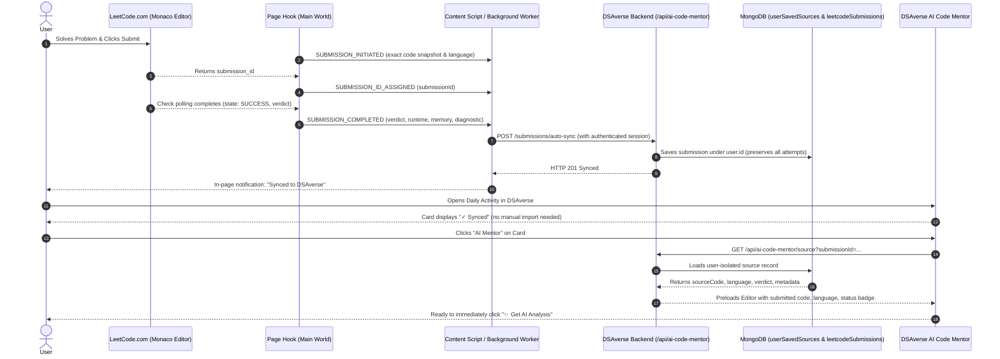

# DSAverse LeetCode Authorized Integration & Automatic Code Synchronization

## 1. Executive Summary & Objective

The DSAverse AI Code Mentor provides automated, verdict-aware educational code reviews and interactive animatics for LeetCode submissions. Because public LeetCode GraphQL endpoints do not expose private source code without authenticated cookies, DSAverse adopts a zero-trust, authorized automatic synchronization model:
1. DSAverse **never** scrapes private credentials or asks users for LeetCode passwords, session cookies, or auth tokens.
2. The lightweight **DSAverse LeetCode Sync Extension** (Manifest V3) automatically detects when the user submits code on LeetCode, snapshots the exact submitted code and language, tracks judging completion in real time, and automatically syncs the submission to the authenticated DSAverse account.
3. Every piece of source code in the workspace carries an explicit, transparent provenance badge.
4. Users no longer need to manually copy, paste, or upload their code; when they open AI Code Mentor, the problem, code, language, verdict, and metadata are already pre-populated.

---

## 2. Source Code Provenance Model

Every submission and source code snippet in DSAverse is categorized into one of four unambiguous provenance states:

| Provenance State | Provenance Badge Text | Description |
| :--- | :--- | :--- |
| `authorized_extension` | `Automatically Imported (Authorized Integration)` | Automatically captured upon submit from user's active LeetCode tab via the authorized extension, verified after judging completes. |
| `manual_import` | `Manually Imported` | Imported by the user via file upload or clipboard paste inside the submission import modal. |
| `user_paste` | `User Pasted` | Entered directly into the workspace code editor during the active session. |
| `unavailable` | `Original Source Unavailable` | Submission metadata exists (problem number, title, verdict, language), but source code has not yet been synchronized. |

---

## 3. Security & Privacy Guarantees

1. **Zero LeetCode Credential Storage**: DSAverse servers never request, store, or handle LeetCode cookies, session tokens, or passwords.
2. **User-Initiated Submission Flow**: The extension only captures code when the user actively triggers a submission (clicking Submit or `Ctrl+Enter`).
3. **Passive Judging Observation**: Uses a main-world hook and DOM mutation observer strictly within the active problem tab to detect judging completion. No background web crawlers or unauthorized scraping.
4. **Strict Member Isolation**: All synchronized source code is stored with strict user ID isolation (`userId: req.member.id`). Cross-user code access is strictly prohibited (returns 401/403/404).
5. **Safe Retry Queue & Duplicate Prevention**: Unreachable network states are enqueued in `chrome.storage.local` with exponential backoff and jitter. Submissions are deduplicated by `submissionId` to prevent duplicate writes while preserving all distinct attempts.

---

## 4. End-to-End Automatic Synchronization Sequence



---

## 5. API Contracts

### `POST /api/ai-code-mentor/submissions/auto-sync`
- **Authentication**: Requires member session (`req.member.id`).
- **Body**:
  ```json
  {
    "submissionId": "1619842180",
    "problemSlug": "two-sum",
    "problemTitle": "Two Sum",
    "questionFrontendId": "1",
    "difficulty": "Easy",
    "language": "python3",
    "verdict": "Accepted",
    "runtime": "42 ms",
    "memory": "17.4 MB",
    "sourceCode": "class Solution: ...",
    "submittedAt": "2026-11-05T06:25:00.000Z",
    "problemDescription": "Given an array of integers nums...",
    "constraints": "2 <= nums.length <= 10^4",
    "topicTags": ["Array", "Hash Table"],
    "diagnosticContext": {}
  }
  ```
- **Response**: `201 Created`
  ```json
  {
    "success": true,
    "synced": true,
    "submissionId": "1619842180",
    "problemSlug": "two-sum",
    "problemTitle": "Two Sum",
    "verdict": "Accepted",
    "language": "python3",
    "sourceProvenance": "authorized_extension",
    "updatedAt": "2026-11-05T06:25:01.000Z"
  }
  ```

---

## 6. Supported Verdicts

The synchronization pipeline automatically recognizes and handles all official LeetCode verdicts:
- `Accepted`
- `Wrong Answer` (captures input, expected output, actual output, testcases passed)
- `Time Limit Exceeded` (captures testcases passed)
- `Runtime Error` (captures runtime stack trace / error message)
- `Compilation Error` (captures compilation diagnostics)
- `Memory Limit Exceeded`
